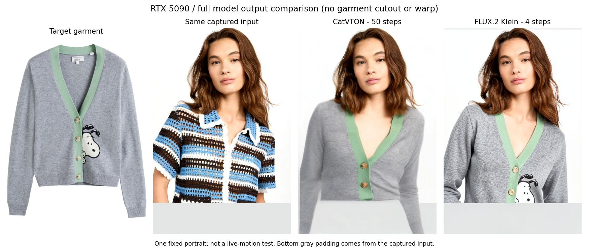

# 换衣模型替换评估（2026-10-26）

## 最新约束与固定样衣实测

用户先允许固定几件样衣实验，随后明确 **“任意衣服图片上传即穿”也必须保留**。因此固定样衣只能作为独立对照，不能用预先训练的衣柜取代通用上传，不能把通用上传的慢速路径隐藏后宣称整体问题已解决。

已在原RTX5090隔离跑通[RTV官方源码](https://github.com/ZaiqiangWu/RTV)与已训练的lab_03黑色山峰图案T恤。完整人体与半身裁切各取官方公开视频24帧，三帧预热另计：

| 测量边界 | 完整人体405×720 | 半身裁切694×720 |
| --- | ---: | ---: |
| 全流水线中位数 | 110.0 ms | 122.9 ms |
| 按平均流水线耗时换算的原生吞吐 | 8.74帧/秒 | 8.11帧/秒 |
| 仅服装生成器 | 8.59 ms | 8.64 ms |
| 人体估计 / DensePose中位数 | 36.40 / 38.20 ms | 36.64 / 35.43 ms |
| 生成 / 检测失败原图透传 | 24 / 0 | 24 / 0 |

这里包含BEV/SMPL、GPU EGL渲染、DensePose、512分辨率生成与合成；不含网络、编解码、摄像头或浏览器，也不含插帧。不能拿8.6ms生成器耗时宣称百帧直播。样本跨24秒抽取，尚不能证明连续帧无闪烁或真人低延迟。已检查的背面第192帧没有出现前胸的大山峰图，后领仍有一个小亮标；这不代表原Klein生产版本的背面问题已修复。

**决定：暂不接入生产界面。** 一是完整处理仍约8–9帧/秒，二是RTV需逐衣训练，不能接受任意新衣服图片作为条件；并且官方明确其合成衣层不会移除原衣。保留的[独立无界面适配器](../server/rtv_runtime.py)仅用于复核。原FluxRT服务和8022隧道已恢复，用非内置服装ID和新衣图片成功返回3个完整生成帧，确认通用上传路径仍可用；这是功能探针，不能代替相机体验验收。首帧冷启动约2.66秒也已单独记录。

额外两轮无模型WebSocket回显：同一SSH路线32KiB双向负载中位约75.8/75.6ms，4KiB约36.6ms，32字节小消息约122.8/121.1ms。出现明显的包大小相关延迟，提示需检查传输缓冲/报文调度；没有证明具体是TCP延迟确认、WiFi或平台SSH中继。该探针是Python客户端，不能直接解释之前真人约304ms剩余项。临时探针隧道还观察到一次连接reset，已记录，未据此推断所有历史卡顿原因。

完整数字、源码提交、依赖适配和测量边界见[固定样衣评估](fixed-garment-evaluation-20261026.json)；[半身正背面对照图](fixed-garment-comparison-20261026.jpg)左为公开输入、右为RTV输出。当前流畅度目标仍未达到，不再让用户重复刷新验证同类微调。

复核环境：RTV提交dd165d5f，Detectron2提交b0fe2f0，作者ROMP分支提交22e6ae9；独立Python3.12环境继承支持5090的Torch2.11/CUDA13，NumPy1.26.4、OpenCV4.10。未照旧requirements降级到不支持5090的Torch2.4。Detectron2/ROMP编译输出放OS TEMP。候选目录的libegl1解包提供GPU EGL；启动需将其usr/lib/x86_64-linux-gnu加入LD_LIBRARY_PATH。仅此隔离环境的romp/main.py将`default_settings = romp_settings(input_args=[])`替换为`default_settings = None if os.environ.get('RTV_BEV_ONLY') == '1' else romp_settings(input_args=[])`，避免导入未使用ROMP时下载无关模型，BEV三个权重仍完整加载。项目适配器设置该开关，关闭GUI、同步计时并统计原图透传；没有更改既有FluxRT环境。

结论：CatVTON 应退出实时主路线；需要同时替换“静态换衣结果裁衣层再 Warp”的处理核心。FLUX.2 Klein + FluxRT 在本轮样例的服装细节上更好，已可运行，但速度和真人动作质量尚不足以确认最终替代。

## 当前架构决定：停止参数微调，目标体验未达到

2026-10-26 用户在上传窗口和本地显存修复后再次反馈“仍明显卡顿”。最后真人记录：320低延迟档30帧，推理中位122.25ms、上传确认153.6ms、RTT233ms、采样到绘制490.6ms/P95844.6ms、生成约5.41FPS；384档约882ms/4.44FPS，512档约783ms/3.76FPS。窗口确认为3，采集约4–5ms，说明新代码已生效，体感问题不是忘了刷新；不再以自动化266ms结果宣称真人已流畅。

停止的假设是“逐帧通用图像编辑+空间缓存+整帧补帧+远程图片传输，继续调步数/尺寸/等待即可满足类似Anywear的实时穿着与转身体验”。换WebRTC可以调整传输，但不能自动赋予模型视频时序、服装前后结构或更高原生生成速度；单张正面参考仍不能保证真实背面细节。当前可用版本和原始日志保留，前端、衣柜、上传、GPU连接及诊断可复用；需要重新验证的是生成核心和实时媒体链路，而非先把所有界面推倒。

用户追问后的边界复核：同一30帧中服务处理中位130.72ms（含推理122.25ms），采集4.95ms，显示缓冲15.2ms。对每帧从总耗时扣除服务、排队、采集与显示后，再统计剩余项，中位为303.67ms；此项包括传输、缓冲及消息调度，不能直接等同网络延迟，也不能与控制RTT再相加。按显示事件首尾间隔计算约4.77FPS，与界面滚动生成估计5.41FPS测量边界不同。当前工作空间再次TIMEOUT/CANCELLED，纯SSH echo与HTTP持久连接拆分未执行；无法据此认定具体是WiFi、SSH中继、丢包还是浏览器调度占主导。自动化通过只验证功能/局部机制，不能代替真人体验验收。此轮未修改代码或再次更换参数。

### 截至本次核查的候选准入

| 路线 | 一手证据 | 决定 |
| --- | --- | --- |
| LiveVVT | [官方README](https://github.com/caoyushe/LiveVVT)仍只有代码准备中说明；[论文](https://arxiv.org/abs/2608.26714)是有视频时序/外观记忆的滚动生成方案 | 方向相关，但不能把论文指标当可部署代码或本机速度；当前不安装占位仓库 |
| StreamV2V | [官方说明](https://github.com/Jeff-LiangF/streamv2v)提供4090实时摄像头视频转换，展示风格化、换脸和连续文本生成 | 可研究时序与传输，未提供特定样衣/正背面换衣保证，不能当现成VTON替代 |
| MagicTryOn / Turbo | [官方仓库](https://github.com/vivoCameraResearch/Magic-TryOn)有代码与权重；Turbo公开入口是bidirectional inference，自定义流程需视频、掩膜、DensePose等 | 可做视频换衣研究，不据“Turbo”名字认定为低延迟直播；未验证因果摄像头入口和本机实时表现 |
| RTV逐衣训练 | [官方仓库](https://github.com/ZaiqiangWu/RTV)明确逐衣网络、RTX3060以上和合成叠加且不移除原衣；[训练指南](https://github.com/ZaiqiangWu/RTV/blob/main/training_instructions.md)需要真人穿实物、4K多姿态视频及分割，再逐件训练；已有[官方权重](https://huggingface.co/wuzaiqiang/rtv_ckpts/tree/main) | 仅作为固定样衣实验候选。并非单图即用，也不能保证满足完整替换、半身和背面要求；不能悄悄退回用户已拒绝的贴片效果 |
| 当前Klein / FluxRT | 本项目三轮真人反馈不达标；[官方benchmark](https://github.com/tensorforger/FluxRT/blob/main/benchmark.md)为无服装参考、576×320、4倍插值配置 | 保留对照，停止继续参数试错；显示FPS不能替代生成FPS或动作延迟 |

现阶段没有在上述核查候选中验证到“免按秒API、任意样衣单图、完整真实换衣、低延迟连续动作、可靠转身背面”同时成立的直接替代。不能由此断言所有免费路线都不可能，也不能承诺重构必然达到Anywear。

下一条路线须先明确是否接受固定服装/逐衣训练，然后在隔离环境用正面→侧面→背面→正面的同一段视频验收：身份、半身构图、衣服主要结构、前胸图案位置、抬手遮挡恢复及连续生成速度；有代码/可用权重/能跑通且通过这些项目后，才考虑接入预览。此阶段不再要求用户反复刷新20–30秒验证同类微调，不购买GPU、不连接付费API、不覆盖已认可的正面版本。最后真人原始数值见[架构复核记录](architecture-reassessment-20261026.json)。

---

最新传输诊断（同日，流畅档真人仍反馈卡顿）：新真人320档51帧的模型推理中位已降至125.2ms，但上传确认中位257.4ms、RTT中位307.2ms，生成约3.44FPS，采样到绘制中位392.9ms。根因之一是客户端只有一个待确认上传，慢确认直接限制采集发帧，不能再认定“改分辨率就能解决”。现改为协商最多3个待确认上传、按ID确认、编码仍单任务，WebSocket待发送超过128KiB暂停采集；服务器依然只保留最新一帧等待生成。输入发送上限按320/384/512生成档分别为9/8/6FPS，防止无效上传挤占网络。固定512 JPEG90采集及原生成档位保持；320采集候选曾出现编码长尾，已撤回。

真实浏览器/SSH/5090的公开平移人像对照：旧单确认正常网络约5.18个显示原帧/秒、中位367.8ms；新窗口约6.42FPS/266.7ms，复测7.45FPS/265.9ms。另在浏览器对ACK消息额外延迟300ms，旧/新约2.09/7.29FPS、中位363.3/296.6ms；这是确认消息延迟实验，**不是整个网络300ms延迟或真人复测保证**，空间缓存与网络也随帧间隔变化。完整报告见[上传窗口记录](upload-window-20261026.json)。

同时确认本机旧CatVTON服务8020空闲且无连接，安全停止后4060显存占用从7383降至3418MiB；不据此断言所有浏览器停顿都由它引起。`start-demo.ps1 -Remote`现只连接完整画面服务8022并等待其就绪，跳过本机旧模型；`-LocalBaseline`可明确恢复本机旧对照。没有更换模型、步数、生成档位或付费服务；背面问题仍未解决。若真人复测仍无法接受，下一步须重新审视“当前逐图生成+远程链路能达到目标体验”的假设，停止继续只调参数。

最新流畅档（同日，用户复测“差别不大”后）：真实用户trace `023246d5-b540-4164-8b15-fa42ea18fec5`共87个显示原帧，使用低延迟档、无补帧，采样到绘制中位367.4ms/P95485.8ms，推理中位207.3ms，生成约4.6FPS；前次主要针对平滑播放的修复未触及其主要瓶颈。用户明确选择“流畅优先，允许小字和纹理略有下降”。现新增并默认流畅320×320，另有均衡384×384和原细节512×512；均为完整画面、原VAE、2步，不裁人体、不贴衣层。采集仍512×512，服务器整帧缩放；切档复用模型权重并清除不同尺寸的空间KV缓存、重建掩膜和补帧历史，避免重新加载权重或混用旧姿态。

真实浏览器→SSH→5090的同一公开人像平移探针，细节/均衡/流畅/细节复测顺序下，推理中位238.5/163.7/132.8/239.1ms；对应采样到绘制中位426.3/362.5/329.3/437.6ms。各轮RTT变化明显，不能把端到端差异全部归因于分辨率，流畅档实测生成约5–8FPS而非原生30FPS。黑色胸前图案、灰绿针织开衫、白色细肩带三件输出已目视检查：完整穿着/主要图案/吊带结构仍在，小字和织物纹理更软。流畅档RIFE兼容已验证，补帧仍是显示平滑，不算模型生成提速。21项回归及生产构建通过；真人流畅档体感待复测，背面图案问题仍未解决。原始数值与真人改前记录见[流畅档报告](fast-generation-profiles-20261026.json)。

最新修复与限制（同日，真人转身反馈后）：已确认正面胸前图案会被生成到背后。三轮提示词对照未通过双向验收：详细前后条件能去除背部图案，却会把正面人物转成背面；两个较短版本保住正面但仍复制图案到背部。依项目“三次失败停止”规则终止提示词尝试，保留原生产提示词，**背面问题未修好**。不能继续假定该2步通用编辑模型只靠提示词即可可靠理解服装前后结构。

卡顿部分已落地：补帧播放新增最多90ms、采样帧龄420ms的等待预算；过时中间帧跳过，保留最新完整模型原帧；生成画面遮住原始预览时不再重复WebGL上传/绘制，停止生成后自动恢复；后端关闭已压缩图片的WebSocket deflate。真实浏览器→SSH→5090的自动化公开人像平移对照，旧播放/新播放/旧播放复测各取20个预热后原帧：采样到绘制P50为653.2/475.5/640.7ms，P95为815.6/508.9/719.4ms；播放等待P50为184.3/0.1/185.5ms。该结果是减少旧姿态重放等待，**不是模型生成加速或真人转身测试**；推理中位仍约239ms，实际生成约3–4FPS。丢弃过时补帧会减少可见插值帧数，不能保证体感始终更平滑，需真人复测。

未采用的加速候选：CPU线程16→1/2收益约1ms；VAE channels_last中位247.96ms，原格式237.69ms/复测239.09ms，且输出像素有明显变化，已撤销。保留512×512、2步、原VAE和原服装参考。20项Playwright、生产构建及Python语法检查通过，服务与8022隧道已按用户授权恢复。完整数值记录与失败边界见[本轮报告](turnaround-latency-20261026.json)。

后续实现更新（同日）：默认前端已接入“完整画面生成 · 5090 实验”，使用二进制 JPEG WebSocket，不裁衣、不做骨骼 Warp、无需肩部检测。真实浏览器/隧道/5090 三件参考衣服各成功连续生成 6 帧，并完成切换、停止清屏和 390px 布局检查；生成约 2.5–2.9 FPS，各件样例预热后采样到绘制中位约 350–411 ms。输入仍是平移固定公开人物图，不能证明真人抬手、转身、遮挡或无闪烁。原始记录见 [full-frame-smoke-20261026.json](full-frame-smoke-20261026.json)。下文保留此前隔离测试的不同测量边界。

流畅度更新（同日，用户已认可原型穿着效果）：保留 512×512、2 步和原 VAE，协议改为采集/生成/回传并行、服务仅保留最新等待帧；不再串行等待整帧显示后上传。新增可切换的完整画面 RIFE 补帧，默认“平滑显示”，支持“低延迟”原帧直显。两件衣服各档 24 个原始输出实测：低延迟约 3.4–3.8 真实 FPS、采样到绘制中位约 422–453 ms；平滑显示约 11.2–12.6 显示 FPS，其中真实生成约 2.9–3.3 FPS，采样到绘制约 691–696 ms。平滑档包含约 200 ms 显示缓冲，不能当作生成加速或低延迟。补帧为整幅生成画面，不是骨骼衣服贴片。构建及 17 项回归通过；测量仍是平移公开人像，不代替真人补帧质量验收。记录见 [stream-performance-20261026.json](stream-performance-20261026.json)。

左至右：参考衣服、实际浏览器捕获人物、CatVTON 50 步、FLUX.2 Klein 4 步。两者均为完整模型输出，没有裁衣或 Warp。CatVTON 的狗图案丢失，Klein 能生成相应图案和较清楚的针织纹理；Klein 的图案大小、位置和纽扣仍不完全一致。底部灰块来自原始输入中的人工补齐区域，不能据此判断模型裁切。第二件奶白粉边图案衬衫也完成 2/4 步输出检查，但两件静态衣服不能代表所有款式或视频稳定性。

## 5090 实测

| 路径 | 配置 | 实测 | 含义 |
|---|---|---|---|
| CatVTON 原浏览器链路 | 512×768，50 步 | 推理 2.732 s；HTTP 4.042 s | 历史同一人物/服装输入，原掩膜；与新模型的处理边界不同 |
| Klein 静态完整帧 | 512×768，4 步，双参考图 | 两件分别 0.903 / 0.905 s | 未编译、无缓存、无网络；含模型内部预处理和编解码 |
| Klein 静态完整帧 | 512×768，2 步 | 第一件首次 1.429 s；第二件预热后 0.549 s | 首次运行与预热后不能当成同条件均值 |
| FluxRT 连续缓存 | 512×512，2 步，无编译 | 4.05 个真实生成帧/s；中位 247 ms | 10 个移动帧，前 4 帧预热不计；无插值 |
| FluxRT 连续缓存 | 512×512，2 步，编译 | 3.29 帧/s；中位 247 ms | 首个移动帧 821 ms；首次编译帧 46.27 s 另计 |
| FluxRT 低分辨率 | 576×320，2 步，编译 | 4.84 帧/s；中位 178 ms | 40 个移动帧；最后 30 帧 5.45 帧/s；首次编译帧 36.76 s 另计 |

所有 FluxRT 测试：服装参考图 256×256，BF16，空间缓存开启，原始 VAE，INT8/上采样/RIFE 插值均关闭。高分辨率静态档峰值模型分配约 15.9 GiB；流式 512 档约 19.6 GiB，低分辨率档约 19.1 GiB。显存是 PyTorch 峰值 allocated，不是整卡总占用；旧服务另占显存。测试后评估进程已退出。

连续输入是同一张公开人物照片的水平平移，**没有测试真实人物的转身、抬手、半身出框或端到端相机延迟**。耗时含输入帧编码、模型生成和输出解码，不含视频压缩、网络、相机采集或浏览器显示。缓存能加速静止内容，不代表运动区域总能以相同速度更新。低分辨率画面的人物更小，服装细节也减少。

完整原始记录在 [model-evaluation-20261026.json](model-evaluation-20261026.json)。编译档预热后仍出现首个移动帧停顿；本报告不将其未经剖析的原因断言为网络或重新编译。

## 候选取舍

- **FLUX.2 Klein + FluxRT：继续作为候选。** 参考衣服编辑已验证能运行，生成完整人物画面，可以避免旧裁衣贴片。它是通用编辑模型，尚未证明服装严格还原和真人动作连续性。[模型说明](https://huggingface.co/black-forest-labs/FLUX.2-klein-4B)、[FluxRT 源码](https://github.com/tensorforger/FluxRT)。
- **FASHN VTON 1.5：静态质量备选。** 官方提供照片换衣流程，没有本轮可直接接入的实时视频推理链路；未安装、未测速，不能宣称一定优于 Klein 或满足实时。[官方实现](https://github.com/fashn-AI/fashn-vton-1.5)。
- **DM-VTON：可做低延迟旧架构对照。** 官方公布轻量换衣框架和速度，但旧依赖栈、素材限制、细节忠实度及本机速度仍需独立验证；本轮未安装。[官方实现](https://github.com/KiseKloset/DM-VTON)。
- **LiveVVT：目前无法直接部署。** 官方仓库说明代码仍在准备，不能凭论文的 FPS 把它列成已可替换的实现。[官方仓库](https://github.com/caoyushe/LiveVVT)。

[FluxRT 官方 benchmark](https://github.com/tensorforger/FluxRT/blob/main/benchmark.md) 为 576×320、无参考图、4 倍插值配置；其 100% 动态区域 0.1829 s/次对应约 5.47 次生成/s，表格显示 22.15 FPS。插值改善显示平滑度，不能消除生成、网络和动作跟随的延迟。

## 隔离部署与下一道验收

远端工作根目录 `/output/live-vton/candidates/fluxrt`，模型 `FLUX.2-klein-4B`（19 个文件，15,980,141,736 bytes，逐文件 SHA256 校验通过），源码 `source`，独立 Python `venv/bin/python`，结果 `results`，复现脚本 `evaluation`。FluxRT 固定提交 `32206e8255b085b9075e05d389781bcbc728d513`；唯一兼容改动是在 `interpolation_exp=0` 时跳过未使用的 RIFE 初始化及编译。

运行栈：torch 2.14.1+cu130 / torchvision 0.29.1+cu130 / diffusers 0.42.0 / transformers 5.20.2 / accelerate 1.15.0 / optimum-quanto 0.2.7。未改原 CatVTON 依赖环境；本机 4060 为 8 GiB，不适合本次约 20 GiB 的完整流式档。

下一阶段应直接传完整生成视频帧，处理积压时丢旧帧，并携带采集和输出时间戳。先用两件衣服的左右移动、抬手和半身视频验证服装、身份、遮挡、闪烁，再测网络后的真实生成 FPS 和相机到屏幕延迟；未通过前不接成默认路线、不宣称达到 Kivicube 效果。
