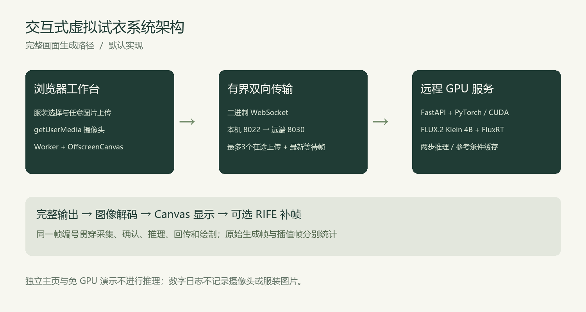
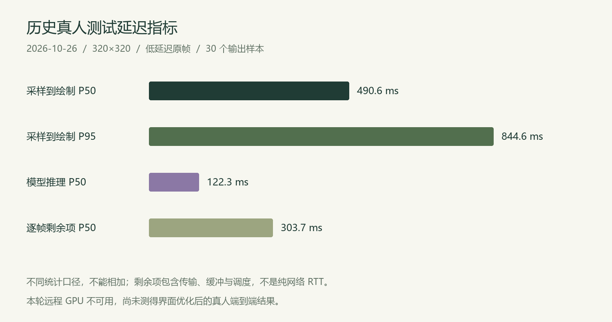
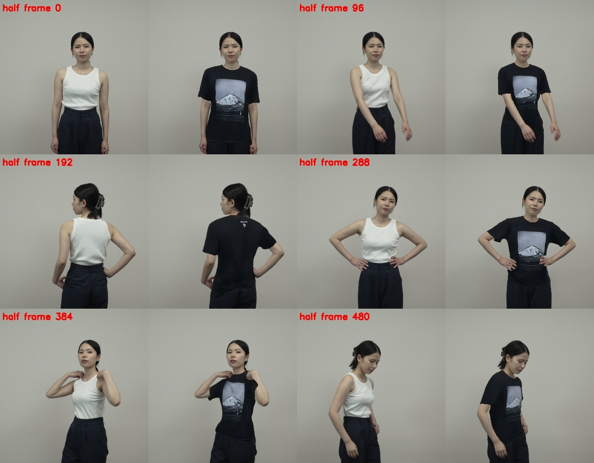

# 基于深度学习的交互式虚拟试衣系统设计与实现

本科毕业论文

学院：待填写　专业：待填写

学生姓名：待填写　学号：待填写

指导教师：待填写

完成日期：2026年11月

## 摘要

针对线上服装选购中难以直观判断穿着效果的问题，本文设计并实现了一套基于深度学习的交互式虚拟试衣系统。系统采用浏览器与远程图形处理器协同的架构，支持摄像头画面采集、内置服装选择、任意服装图片上传、完整画面生成、本机衣柜、偏好记忆及运行耗时诊断。前端使用 JavaScript、Vite、Canvas 和 Web Worker 构建，后端基于 FastAPI、PyTorch 与 CUDA，集成 FLUX.2 Klein 4B 和 FluxRT 实现服装参考图引导的图像生成。为降低主线程阻塞与旧帧积压，系统采用后台异步编码、有界上传窗口、最新等待帧替换、缓存复用和过期补帧跳过等机制，并区分模型原始生成帧率与包含插值的显示帧率。历史真人测试中，流畅档的30个原始输出帧采样到绘制延迟中位数为490.6 ms，95分位为844.6 ms，实际原帧显示约4.77帧每秒，表明当前实现仍受到逐帧生成和远程传输的共同制约。本文进一步分析了固定样衣方法的适用边界，提出保留任意服装上传、加强时序一致性和拆分传输瓶颈的改进方向。系统验证了完整生成路径及工程优化方案的可行性，但尚未实现高流畅度实时试衣与可靠的服装正背面一致性。

关键词：虚拟试衣；图像生成；WebSocket；异步编码；端到端延迟

## Abstract

This thesis presents an interactive virtual try-on system for visualizing garment appearance during online clothing selection. A browser client captures camera frames and accepts built-in garments or arbitrary garment reference images. An IndexedDB wardrobe preserves uploaded garment images locally, while small preferences are stored separately. A remote GPU service performs full-frame image editing using FLUX.2 Klein 4B and FluxRT. The implementation combines JavaScript, Vite, Canvas and Web Workers on the client with FastAPI, PyTorch and CUDA on the server. Worker-based encoding, a bounded upload window, replacement of stale waiting frames, cached garment references and age-aware interpolation playback are used to reduce blocking and accumulated delay. Native generated frames and interpolated display frames are measured separately. In a historical human-camera session containing 30 original output frames, median capture-to-draw latency was 490.6 ms, the 95th percentile was 844.6 ms, and the observed original-frame display rate was approximately 4.77 frames per second. These results demonstrate a functional prototype while exposing limitations in framewise generation, remote transport and temporal garment consistency. Fixed-garment experiments provide additional evidence but cannot replace arbitrary-image try-on. Future work should improve causal temporal modeling, front-to-back consistency and reproducible transport measurements.

Keywords: virtual try-on; image generation; WebSocket; asynchronous encoding; end-to-end latency

## 第1章 绪论

### 1.1 研究背景与意义

服装图片能够展示颜色、款式和局部细节，却不能直接说明服装在具体人物身上的视觉效果。浏览者通常需要结合模特图片与自身经验进行判断，人物体型、姿态、构图和原有穿着的差异会增加判断难度。虚拟试衣以人物图像和服装信息为输入，尝试生成目标人物穿着指定服装的视觉结果，为线上选购和数字展示提供交互手段。

面向摄像头的试衣任务比单张图片编辑具有更多约束。用户会持续移动，输入画面随时间变化；即使一张生成图足够自然，若输出长期滞后于相机，或转身后衣服图案出现反向复制，仍难以获得可信的试穿体验。因此，摄像头试衣需要同时考虑单帧效果、运动跟随、时序连续性、延迟及系统可用性。

本课题的意义在于将图像生成能力落实为可操作、可测量的交互系统。系统不仅需要调用模型，还需要处理浏览器授权、图像格式、帧调度、连接故障、资源释放和性能指标解释。通过实际运行记录识别瓶颈，有助于避免以单次模型耗时或补帧后的显示数量替代完整体验评价。

### 1.2 相关研究概述

图像虚拟试衣通常需要解决服装形变、人体对齐与图像融合。CP-VTON研究服装特征保持与形变结合的问题[1]，VITON-HD关注高分辨率试衣中的错位处理[2]。这类方法说明，目标服装的外观信息与人体结构之间需要建立相容关系。

扩散生成研究推动了图像合成质量的发展。DDPM建立逐步去噪的生成建模方法[3]，潜空间扩散通过在压缩表示中处理图像降低生成计算负担[4]。在试衣方向，CatVTON通过简化结构和空间拼接组织人物与服装条件[5]。这些工作提供了单帧试衣的研究基础，但不能据此推断在远程摄像头系统中能够获得相同的速度与连续性。

本项目当前使用FLUX.2 Klein 4B作为图像编辑核心，并通过FluxRT组织流式推理[6-7]。其作用是提供参考图引导的完整画面输出，本文并未重新训练基础模型。固定样衣RTV作为另一种研究对照被隔离评估[8]。本项目的主要工作是架构集成、交互实现、调度优化与证据分析。

### 1.3 研究内容与目标

本研究围绕四项工作展开。首先，构建包含主页、试衣工作台、服装衣柜和操作帮助的浏览器应用。其次，实现人物帧与服装图片的传输以及完整画面生成链路，使用户可以使用内置样衣或自定义图片。再次，优化采集编码、队列和显示过程，建立逐帧可关联的数字日志。最后，通过历史真人记录、公开素材对照和自动化测试分别分析性能、视觉效果与工程可靠性。

目标分为功能目标与体验目标。功能目标包括半身构图输入、任意服装图片上传、完整输出展示、故障降级和明确的状态反馈。体验目标包括更高的原始生成帧率、更低的采样到显示延迟和更稳定的服装正背面。后者仍是持续改进方向，不能将计划指标写成完成结果。

### 1.4 论文结构

第二章介绍相关技术，第三章分析系统需求，第四章给出总体设计，第五章说明关键实现与性能优化，第六章组织测试和结果分析，第七章讨论局限并总结研究工作。附录提供模块索引、复现实验步骤和数据解释规则，便于将论文内容与源码及实验记录对应。

## 第2章 相关技术与理论基础

### 2.1 条件图像编辑与潜空间表示

虚拟试衣需要同时保留人物身份与目标服装外观。本文把摄像头人物帧作为待编辑图像，把用户选择的服装图作为参考条件，再由文本指令说明编辑目标。模型输出的是包含人物、服装和背景的完整图像；界面不把服装参考图直接覆盖到躯干上。服装边界、褶皱和遮挡由图像生成过程推断，错误也可能由该过程产生。

生成模型通常不在原始像素网格上执行全部运算。变分自编码器将图像映射为较紧凑的潜空间表示，生成网络在该表示中计算，再由解码器恢复为像素图像[4]。文本编码器把编辑指令转换为数值条件，参考图像提供颜色、轮廓和图案信息。这些条件并不构成几何约束的严格证明，文本要求保持人脸或衣服图案，也不能保证每次输出都正确。

FLUX.2 Klein 4B的官方模型卡将其描述为约40亿参数的整流流Transformer，并提供多参考图像编辑能力[6]。本文使用已经发布的模型权重，通过FluxRT接入连续输入，不重新训练基础模型。本文未实现服装版型重建、布料受力、人体碰撞或实物尺码估计，因此结果用于视觉预览，不能据此判断真实衣服是否合身。

### 2.2 模型选择与三种生成路径的区别

本文保留了三种具有不同约束的方案。CatVTON本身是生成式图像试衣方法；早期项目把它生成的静态结果进一步提取为衣层，再通过姿态驱动显示。衣层变形的速度不代表CatVTON能逐相机帧生成新褶皱。当前主链路使用FLUX.2 Klein与FluxRT对完整图像进行编辑，可以接收新服装图片，但它仍是通用编辑模型，未因此获得专门的服装视频时序约束。RTV采用与服装对应的模型权重，适合作为固定样衣对照，不能直接承担任意新服装图片即时输入的需求[5-8]。

| 技术路线 | 本项目中的作用 | 主要限制 |
| --- | --- | --- |
| CatVTON加衣层变形 | 保留的旧版对照，区分模型原图与后续显示 | 静态衣层难以重新生成随姿态变化的结构 |
| FLUX.2 Klein加FluxRT | 当前完整画面生成主链路 | 单帧编辑仍有延迟、纹理变化和时序不一致 |
| RTV固定样衣模型 | 隔离环境中的公开素材对照 | 权重与服装对应，不能替代通用上传 |

本文对模型的选择依据是输入方式与输出形式是否符合需求，而不是直接引用某一项目的最高帧率。模型官方演示、无服装参考的基准和本项目带参考图的连续输入，具有不同的计算与传输负担，应分别评价。模型名称中的“实时”也不等于本系统已达到实时跟随。

### 2.3 浏览器采集与图像坐标

浏览器通过getUserMedia申请摄像头流，以video元素承载视频，Canvas负责输入整理和输出绘制。requestVideoFrameCallback在视频帧提交显示时提供回调与相关元数据[9]。项目通过呈现帧编号识别新帧；显示器多次刷新同一相机帧时，不重复快照和编码。requestAnimationFrame负责绘制调度，其触发频率不能直接当作相机采样率。

摄像头输入可能是横屏或竖屏，而模型采用方形输入。项目先按比例缩放，再用白色补白填充到512×512。以960×720相机帧为例，有效画面缩放为512×384，上下各补64像素。此方法保留真实相机视野，不根据肩部或髋部关键点决定是否接收半身输入。

补白属于模型输入的一部分，却不属于真实相机内容。模型可能在补白区域生成额外衣服，因此显示端必须使用采样时记录的有效区域，仅绘制对应的模型输出。输出为320×320时，上述有效区域映射为中央320×240。这里去掉的是视野外补白，不是把生成衣服裁出来重新贴回人物。采样记录与输出帧编号必须配对，不能用当前视频尺寸替代历史采样尺寸。

### 2.4 后台编码与资源所有权

Web Worker提供独立于页面主线程的执行环境，OffscreenCanvas能够在该环境中进行图像绘制与编码[10]。项目优先将VideoFrame快照交给编码Worker；不支持时退回ImageBitmap，最终才使用主线程Canvas。Worker输出JPEG Blob及有效区域和阶段耗时，主线程再负责网络调度与界面更新。

这种拆分解决的是主线程争用和编码调度问题，不减少GPU生成网络的运算量。系统同一时刻仅保留一个编码任务，避免Worker请求自身排队。可转移图像对象在接收端使用后关闭，停止会话时清理未完成任务；否则即使GPU没有变慢，未释放的位图和回调仍可能占用浏览器资源。

### 2.5 双向通信与异步服务

WebSocket在一个持续连接中承载双向消息，适用于反复发送相机帧与返回结果。FastAPI提供WebSocket接收、发送及断线处理接口[11]。项目用JSON传控制字段，用二进制消息传逐帧JPEG，既保留帧编号又避免每个人物帧都转换为Base64文本；初始化中的服装参考图仍采用Data URL，只在会话建立时发送。

浏览器和服务端的异步函数用于协调等待，不意味着一个GPU能同时执行无限次推理。项目以单工作线程承接模型调用，事件循环继续处理接收、确认和心跳；对共享模型缓存则实行单活动会话管理。WebSocket的可靠有序传输也可能保留过时数据，需要进一步结合背压和最新帧策略限制积压。

### 2.6 缓存复用与帧插值

连续试衣中，服装参考和编辑指令在同一会话内通常不变，人物图像却不断变化。因此可以复用条件编码，并根据图像变化选择性更新空间计算。缓存节省重复工作，但错误或过期的空间内容可能影响后续帧；服装切换、分辨率切换和会话变化都需要对应的失效机制。缓存复用不能等同于经过视频训练的长期时序记忆。

RIFE通过中间流估计生成相邻结果之间的插值图像[12]。本项目把它用于可选平滑显示，不作为服装生成模型。低延迟模式直接显示原始生成帧；平滑模式可以提高显示连续性，却可能增加插值计算和等待。若相邻原帧的衣服或人脸已经错误，插值不会获得正确的服装结构。

### 2.7 浏览器持久化与自动化验证

IndexedDB支持异步事务及包括Blob在内的结构化数据，适合保存多张服装参考图；localStorage适合少量字符串偏好[13]。本文按数据用途拆分二者：服装图片与名称保存在IndexedDB，显示档位、收藏ID和上次选择保存在localStorage。浏览器持久化受同源规则和站点数据清理影响，因此本机衣柜不是云端账户，也不保证跨浏览器或跨设备同步。

Playwright以真实浏览器执行点击、上传、刷新及协议模拟等流程[14]。测试可以检查图片是否保存、旧会话是否失效、页面是否发出不应有的推理请求，但不能据模拟图片评价模型生成质量。本文将此类工程测试与真人视觉和延迟测试分开组织，避免把测试通过数量作为换衣效果的精度指标。

## 第3章 系统需求分析

### 3.1 使用场景与角色

主要使用者为希望查看换衣效果的体验用户，以及需要展示架构和分析实验的毕业设计演示者。体验用户关注操作是否清晰、相机是否可用、服装能否上传和结果是否及时；演示者还需要查看阶段耗时、导出数字记录并解释系统局限。

系统按照单个浏览器会话和单个活动推理会话设计。当前没有实现电商账户、订单支付、用户云端衣柜或多用户GPU调度。这些功能不属于现有试衣研究的必要前提，增加它们也不能直接解决运动跟随问题。

### 3.2 功能需求

| 编号 | 需求 | 验收条件 |
| --- | --- | --- |
| F01 | 项目主页 | 展示功能、技术流程、能力边界和材料入口 |
| F02 | 服装选择与上传 | 8件内置样衣，自定义JPG、PNG、WebP不超过8 MB |
| F03 | 摄像头本地预览 | 明确请求授权，允许关闭并释放视频轨道 |
| F04 | 完整画面生成 | 不要求身体关键点齐全，结果保持整幅图像 |
| F05 | 状态与诊断 | 显示服务状态、生成耗时、端到端延迟并导出数字日志 |
| F06 | 故障降级 | 无GPU时提供本地预览和明确标注的交互演示 |
| F07 | 结果保存 | 由用户主动保存当前AI输出，不自动保存相机图片 |
| F08 | 本机衣柜 | 多件服装刷新恢复，支持收藏、重命名、确认移除和临时上传 |
| F09 | 偏好与引导 | 记住设备和画面偏好，按当前状态提示下一步，刷新不自动生成 |

### 3.3 非功能需求

交互方面，常用操作应集中在衣柜、摄像头与生成控制区域，实验性选项降低默认视觉权重。移动端至少应在390像素宽度下保持主要内容可操作，不产生整页横向滚动。可访问性方面，交互控件具有可识别名称、键盘焦点及文本状态，减少仅依赖颜色传达含义。

性能方面，采集与传输保持有界，服务端不积累按到达顺序逐一处理的旧输入。页面隐藏后停止连续生成与渲染调度，降低不必要消耗。功能恢复应由用户明确操作，避免在未知资源状态下自动启动付费GPU。

隐私方面，摄像头仅在授权后使用。真实生成时人物帧会发送到配置的远程GPU，界面应说明这一点；上传服装由用户选择临时使用或保存至当前浏览器的本机衣柜，不构建跨设备云端图像存储；性能日志仅记录数字或布尔指标，不记录图片、提示词和访问凭据。

### 3.4 关键矛盾与范围约束

任意服装图片输入与固定样衣高效生成之间存在适用范围差异。逐衣训练可以将某件衣服的外观编码到特定模型，但用户上传新图并不会自动获得对应训练结果。因此，固定样衣方案可以作为对照，不能替代本课题必须保留的任意服装上传功能。

远程GPU资源不可用时，本地前端测试能验证页面和调度逻辑，却不能产生新的真实推理性能结论。本论文将历史实测与本轮离线工程验证分别描述，保证实验时间、输入和评价边界一致。

## 第4章 系统总体设计

### 4.1 总体架构

系统由浏览器表现层、采集编码层、连接与调度层、模型服务层和诊断层组成。主页采用独立入口，不加载相机引擎、WebGL或推理客户端。进入试衣工作台后再按需加载交互与生成模块，以减少介绍页面的资源负担。

浏览器中的视频帧进入Worker进行编码，经本机8022端口的SSH隧道发送至远程8030推理服务。服务输出二进制图像与计时元数据，客户端完成解码和Canvas绘制。模型服务只监听远程回环地址，浏览器访问入口保持在本地，未新增公开摄像头上传端口。

### 4.2 页面与模块设计

主页负责项目介绍、使用方式、技术流程、材料下载和常见问题。试衣工作台负责服装列表、文件上传、摄像头、本地预览、生成控制、画面保存与日志诊断。实验路径可切换至旧版对照，但默认使用完整画面生成。

前端入口entry.js根据路径加载home.js或main.js。TryOnEngine管理本地视频与旧版对照渲染；FullFrameClient管理生成连接、上传窗口、图像回传和播放；capture-worker.js负责图像编码；LatencyLog整理计时记录。后端fluxrt_server.py集中处理会话与推理，rtv_runtime.py承担隔离的固定样衣评估。

### 4.3 会话与状态设计

系统分别维护相机、服务和生成状态。相机可以处于关闭、授权中、运行或失败；服务检查可以处于加载、就绪或离线；连续生成还具有初始化、运行、暂停和停止状态。例如，相机运行而服务离线时仍应保留本地预览，不能把设备故障和模型故障合并成一个错误。免GPU演示具有明确标识，不产生真实换衣结果。

开始生成是显式操作。衣柜恢复和偏好读取不会自动申请相机权限，也不会自动发送人物帧。改变服装、档位或显示模式时结束旧会话，再初始化新条件。异步操作携带会话代次，帧编号在会话内递增；旧连接返回的结果即使较晚到达，也不能覆盖新会话。

停止时关闭连接并清理Worker、定时器、上传记录与待播放图像，关闭相机时还停止视频轨道。已经进入GPU的任务通常不能即时取消，因此客户端拒绝过时响应，服务端按顺序结束共享模型操作。该设计处理结果归属，不承诺点击停止即可中断正在执行的CUDA计算。

### 4.4 帧协议与调度设计

初始化消息发送协议版本、服装标识、参考图、输出档位、平滑设置和跟踪标识。服装参考在初始化时发送一次，连续人物帧使用二进制JPEG。服务端返回ready后，客户端才依据协商能力开始采集。关键消息及语义如下。

| 消息 | 主要内容 | 对调度的含义 |
| --- | --- | --- |
| init与ready | 服装条件、会话配置和服务能力 | 建立可用生成会话 |
| frame控制头及二进制图 | 帧编号与同一帧JPEG | 建立输入和结果的对应关系 |
| accepted | 已收到的编号及被替换编号 | 释放上传窗口，不表示推理完成 |
| 结果元数据及二进制图 | 输入编号、阶段耗时和完整输出 | 配对解码、绘制和数字日志 |
| ping、pong及error | 心跳或故障信息 | 判断连接状态并停止失效会话 |

客户端最多允许三个尚未收到accepted的上传。服务端接收协程只有一个等待位置，新帧可以替换尚未开始生成的旧帧；生成协程取走该位置后，在单工作线程上执行模型，再读取最新等待帧。这三个概念分别是在途窗口、待处理位置和正在执行的任务，不能把三个上传窗口理解成三个GPU并发任务。

服务端使用发送锁保证结果元数据与对应的二进制消息连续发送，心跳和确认不会插入这一对消息之间。帧编号允许出现缺口，因为等待帧可能被主动替换；统计应按实际输出编号配对，而非把输入序号差值当作生成数量。单活动会话锁保护全局模型和参考缓存，当前版本不提供多用户公平调度。

### 4.5 本机衣柜与偏好数据设计

内置衣服保存在静态目录中，上传衣服先检查格式和文件大小，再归一化为最长边不超过1024像素的JPEG。用户可选择临时使用，也可把处理后的服装图保存到IndexedDB。本机数据库名为yijian-wardrobe，版本为1，garments对象仓库以id为主键；每条记录包含id、name、blob和createdAt。Blob存放服装二进制，名称最长40个字符，不写入人物帧或生成结果。

项目限制上传衣服最多20件，持久记录中的服装Blob总量最多32 MiB。这是应用自己的容量策略，不是浏览器保证提供的空间。写入操作仅在事务完成后标记为已保存；空间不足、数据库被禁用或打开失败时保留临时服装并提示原因，允许继续试穿和稍后重试。移除已保存服装需要确认，数据库删除成功后再更新界面，避免界面已删而刷新又恢复。

对象URL仅用于当前页面展示，不能作为持久数据。恢复衣柜时从Blob创建新URL，移除和页面释放时回收URL。收藏编号、是否保存上传、是否记住选择和摄像头设备偏好等小数据放入localStorage；读写异常采用默认值回退。重置偏好保留衣柜与收藏，原摄像头不可用时退回默认设备。

本机衣柜受浏览器及来源限制。127.0.0.1与localhost即使指向同一机器，也属于不同来源；更换浏览器、清理站点数据或浏览器回收存储都可能使记录不可见。系统没有账户、跨设备同步或云端个人衣柜，论文不能把本机持久化解释为云端数据库。

## 第5章 系统实现与优化

### 5.1 页面组织与状态引导

前端采用原生JavaScript、HTML和CSS，Vite负责开发服务、构建和模块拆分。入口依据路径加载主页或工作台，主页不初始化相机和推理客户端。工作台把衣柜、相机与生成控制放在主要操作区域，旧版对照收纳到实验选项。参考商品图和免GPU演示均标注来源，避免被误认作真实生成。

引导依据相机授权、设备占用、服务连接和生成状态选择下一步，并保留本地预览与重新检查入口。引导文本建立状态签名，只有状态改变才更新DOM；衣柜数据库不进入采集或绘制循环。重命名及上传名称按文本渲染或转义，避免文件名被当成HTML执行。保存、重命名、移除同一件衣服时设操作占用标记，防止并发事务相互覆盖。

### 5.2 采集坐标与异步编码

完整生成采集固定为512×512。设相机宽高为w、h，缩放比例取512/w和512/h中较小者，有效宽高为w、h乘以该比例；剩余宽高分别平分到两边。Worker把有效区域contentRect与帧编号一起返回。后续模型可以改变输出分辨率，但显示时仍使用该输入帧的区域比例，不能依据新一帧的相机尺寸重新计算。

采集优先使用VideoFrame快照，后备为ImageBitmap，最终才采用主线程Canvas。Worker在OffscreenCanvas上缩放补白，并以0.90质量编码JPEG；一次只允许一个编码任务。图像对象转移后由接收端负责关闭，停止会话时终止Worker并拒绝未完成任务，迟到的旧任务不继续上传。

requestVideoFrameCallback和呈现帧编号用于识别新相机帧，后备路径结合媒体时间判断重复。主线程不为显示器每次刷新重复压缩同一相机帧。日志记录实际编码路径和阶段耗时，便于区分浏览器兼容性回退与模型变慢。历史调试中编码95分位曾从约1008 ms降至13 ms，该记录说明编码长尾可影响交互，不代表之后所有瓶颈均已消除。

### 5.3 有界上传与最新帧处理

发送前先检查WebSocket待发送缓冲，超过128 KiB时暂缓采集；未确认上传达到协商窗口时等待accepted。该窗口上限为3，确认超过30秒则报告会话异常并清理。流畅、均衡、细节档的采集上限分别为每秒9、8、6帧，这些数值是调度限制，不是测得的生成帧率。

服务端接收与生成分离。接收协程持续更新一个最新等待帧，推理协程通过单线程执行器调用模型，事件循环继续处理确认与心跳。新输入可替换等待任务，却不能取消已经执行的推理；故系统仍存在至少一次推理及传输的延迟。上传窗口用于覆盖确认往返，最新等待位置用于限制服务排队，二者共同降低积压。

WebSocket的可靠有序传输仍可能在系统或隧道内等待。即使应用层仅保留一个待处理帧，也不能据此断言网络无缓冲。历史会话曾出现约17秒上传确认异常，而同期模型耗时没有同量级增长；故应保留异常证据，进一步隔离链路，不能将所有延迟归为GPU型号不足。

### 5.4 模型条件输入与生成参数

服务先将参考衣服整理为256像素方形图，建立人物图、服装图及编辑指令之间的条件关系。指令要求以人物帧为主体，更换指定服装并保留脸部、姿态和背景；任意上传使用通用描述，内置样衣另有对应描述。文本表达编辑目标，不构成身份和纹理的硬约束，因此仍需视觉验证。

模型由预训练图像编码、文本条件与生成网络组成，主推理使用PyTorch的inference_mode关闭梯度相关开销[15]，通过CUDA在GPU上执行。权重采用BF16；本项目没有训练、微调或重新蒸馏基础模型。当前服务参数如下，均为工程配置而非最优解证明。

| 配置项 | 当前取值 | 设计目的与代价 |
| --- | --- | --- |
| 人物采集 | 512×512，等比补白 | 统一输入坐标，保留完整相机视野 |
| 生成输出 | 流畅320、均衡384、细节512 | 小尺寸减少计算，也降低小字与纹理表现 |
| 服装参考 | 256像素，按会话复用 | 减少重复条件处理，可能损失细小图案 |
| 推理步数 | 2步 | 优先响应速度，需验证生成质量 |
| VAE与精度 | 原始VAE，主模型BF16 | 保留原解码路径，仍需GPU显存 |
| 其他选项 | 不启用INT8、TinyVAE、超分和编译 | 当前实验不依赖这些加速分支 |

服务先检查收到的人物输入为512×512，再按所选档位缩放后交给模型。官方FLUX.2 Klein模型卡示例采用4步[6]，项目的2步属于速度与质量折中，不能称为官方效果复现。固定种子用于减少部分随机差异，但输入变化、缓存历史与逐帧计算仍可能导致闪烁；固定种子不等于视频时序约束。

### 5.5 条件缓存与空间刷新

会话内的服装参考通常保持不变，因此缓存256像素参考图的VAE编码，人物帧则逐次更新。更换服装或建立新会话时清空参考潜变量与上一张输出，更新编辑指令时使相关条件缓存失效。输出分辨率改变还会重建空间更新控制器，避免沿用不相容的尺寸。

空间缓存按变化区域选择更新块。当前motion-priority策略先用3×3高斯模糊抑制局部噪声，以通道平均平方差形成变化能量，再以16倍压缩划分块。能量大于0.1的强变化块及其一圈邻域优先保留；能量大于0.0025、但位于原更新区域以外的弱变化块获得下一优先级，用原第二圈边缘的部分预算更新这些区域。

策略按优先级排序，并把选中块数量限制在同一缓存输入下原自适应掩码的块数以内。因此它试图改善预算分配，而非增加整幅人物刷新。但两种策略运行后缓存历史可能分化，块数限制不能证明长时间总耗时完全一致。没有足够变化预算时也不能清除所有旧内容，真实视野内的衣服残影仍属于待验证问题。此前全人物刷新方案已因用户反馈更卡而回退，不作为当前有效优化。

静态输入更容易复用缓存；连续动作可能频繁刷新。因此同一照片的重复推理只能验证缓存路径，不能替代真人移动吞吐。缓存也不是专门训练的视频记忆，不能据此保证转身后胸前图案不出现在背面。

### 5.6 完整输出显示与插值管理

结果二进制到达后，客户端关联输入帧记录，检查会话与帧龄，再解码完整图像。超过2000 ms的旧结果在解码前跳过，避免明显过时姿态继续覆盖当前画面；这一保护丢弃了无用输出，却不会修复造成延迟的网络。显示按采样时contentRect映射输出，只剔除方形输入的补白并执行镜像，不提取衣层贴回实时人物。

低延迟模式直接显示模型原始输出。可选平滑模式用RIFE在前后结果之间生成0.25、0.5、0.75三个时间位置的图像，再显示当前原帧。播放缓冲上限90 ms，并按原帧龄420 ms预算减少过期插值。新结果载荷一到达即取消旧补帧任务，不等待新图像解码完成，以防慢解码期间继续播放旧姿态。无论采用何种模式，原帧与插值帧都分别计数。

位图在替换、跳过和停止后关闭，定时器与播放代次同步清理。画布保留低延迟desynchronized设置。完整AI结果覆盖本地预览时，不绘制不可见的视频纹理，本地统计调度降至每250 ms一次；页面隐藏后停止连续生成与绘制，返回后由用户主动启动。这些措施减少无效浏览器工作，不能单独证明远程生成变快。

### 5.7 分阶段日志与延迟计算

每个会话有trace_id，每个输入有frame_id。客户端在快照编码前记录采样起点，绘制后记录终点，使用同一浏览器performance.now单调时钟计算L(i)=t_draw(i)-t_capture(i)。该边界不包括摄像头传感器曝光到浏览器可取帧的全部时间，也不等同于显示器实际发光时刻，论文将其称为“采样到绘制”。

服务端以自身单调时钟记录等待、推理、编码和服务耗时，GPU推理计时前后进行CUDA同步，避免仅测到异步任务提交时间。不同机器的绝对时钟不能直接相减；客户端与服务端通过帧编号配对阶段时长。原始输出显示速率用F=(N-1)/(t_last-t_first)计算，时间单位为秒，N只包含实际绘制的原始输出。

对于同一个原始帧，从总延迟中扣除已测的采集编码、服务、服务排队和显示缓冲，可得到未拆分剩余项。应先逐帧扣除再统计分位数；各阶段的中位数不能直接相加或相减得到总中位数。剩余项仍包括传输、系统缓冲和回调调度，不是纯网络RTT。心跳往返另行统计，不能再次加回已经包含网络的总延迟。

日志仅允许有限数值与布尔指标，不记录图像、提示词和凭据。服务日志使用有界队列，满时丢弃日志而非阻塞推理，并采用轮转文件控制体积；浏览器日志同样限制数量。报告须同时写明样本数、档位、是否插值、预热和丢弃情况，保留超时异常，避免只选择顺利完成的短会话。

### 5.8 本机保存与异常恢复

WardrobeStore封装数据库打开、读取、写入和移除。打开数据库具有超时，事务完成才返回保存成功；当浏览器拒绝存储时，上传流程保留内存中的服装并标为临时，用户仍可选中试穿。重命名已保存条目先完成数据库更新，再同步界面；未保存条目只更改当前内存对象。

衣柜恢复是异步过程，不能覆盖用户在等待期间主动选择的新衣服。客户端以选择版本判断是否仍可恢复上次选择；对象URL仅在本次页面创建。收藏与偏好读取失败时使用默认值，不让小数据损坏阻断相机和生成。不同来源存储隔离、存储空间不足、刷新不自动生成等场景均纳入浏览器回归。

### 5.9 部署边界与服务故障恢复

本地8022经SSH转发至远程回环8030，FastAPI后端只监听127.0.0.1，并限制浏览器Origin为本地8766来源。Origin限制用于约束浏览器访问，不能当作公开部署的完整身份认证；若以后开放公网，需要另行设计TLS、用户鉴权和资源配额。当前版本不承担公共多租户服务。

服务端还校验服装标识、消息类型、图像字节数及像素量，单图解码限制为3,000,000字节和16,000,000像素；这是远端输入约束，与前端原文件8 MB限制不同。前端先归一化，再初始化参考图，不能直接把原文件大小当作线上传输大小。

历史故障中8022仍监听而远端8030服务已随容器重启消失，因此恢复按工作空间、SSH、进程、状态接口和真实协议逐层检查。启动脚本核实原进程身份，重复执行不重复启动，未知监听不触碰；只恢复已运行工作空间的原服务，不自动启动收费GPU。未改公开权重可从上游按清单重新下载，备份主要保留源码、配置说明与版本哈希，凭据不进入仓库和材料包。

### 5.10 项目工作与第三方能力的区分

FLUX.2 Klein模型及权重、FluxRT推理基础、RIFE插值和RTV固定样衣模型属于第三方成果，本文保留对应引用和许可说明。项目未声称提出新的基础生成网络、训练数据集或逐衣模型。本文完成的工作是将这些能力接入浏览器连续试衣，设计帧协议与状态管理，优化后台编码、队列及显示，建立本机衣柜，并用逐帧日志和回归测试解释行为。

工程改动的价值应由可复现问题和证据说明。例如，补白映射解决视野外生成内容被展示的问题；最新等待帧限制应用层积压；IndexedDB解决同浏览器刷新恢复。它们分别对应显示、调度与持久化，不应合并宣称已解决单帧服装质量、全部运动残影和背面语义错误。

## 第6章 系统测试与结果分析

### 6.1 测试环境与证据类型

前端在Windows本地浏览器运行，通过Vite提供本地页面。历史主流程使用远程RTX 5090生成服务，模型为FLUX.2 Klein 4B与FluxRT；固定样衣RTV使用独立环境，不应将该环境的Python与PyTorch版本写成主服务版本。

测试证据分为真人摄像头日志、公开素材固定样衣对照、自动化浏览器测试和离线界面检查。真人日志分析跟随与端到端延迟；公开抽帧对照分析单帧视觉表现；自动化测试检查状态、协议和资源管理。四者的输入与计时范围不同，不能合并为一个笼统的性能成绩。

### 6.2 功能测试设计

| 测试编号 | 场景 | 预期结果 | 验证方式 |
| --- | --- | --- | --- |
| T01 | 无GPU打开主页 | 不加载相机引擎，不请求推理接口 | 浏览器请求检查 |
| T02 | 免GPU演示与上传 | 可选衣、上传、启停相机，不发送推理帧 | 自动化测试 |
| T03 | 后端不可用 | 明确显示离线，保留本地预览，无自动重试风暴 | 模拟503响应 |
| T04 | 半身输入生成 | 不调用旧版衣层裁切和关键点检测 | 协议模拟与回归 |
| T05 | 更换服装与断线 | 旧输出清除，新会话不被旧响应覆盖 | WebSocket模拟 |
| T06 | 重复视频帧与后台页 | 同一帧不重复绘制，隐藏页面不渲染 | 渲染计数 |
| T07 | 补帧与低延迟 | 原帧保留，过期中间帧跳过，切换取消旧播放 | WebSocket模拟 |
| T08 | 本机衣柜刷新 | 多件衣服、重命名、收藏和选择恢复 | 实际IndexedDB流程 |
| T09 | 存储失败与临时上传 | 明确标记临时，可稍后保存和确认移除 | 禁用数据库及操作测试 |
| T10 | 偏好与权限引导 | 重置不删衣柜，权限拒绝给下一步，刷新不自动生成 | 浏览器回归 |

模拟响应只证明客户端遵守协议与显示逻辑，不证明远程模型的衣服效果。自动化摄像头是浏览器测试设备，不能替代真人动作验证。运行次数与最终结果以随附测试报告为准，代码中的断言与论文测试表保持一致。

### 6.3 历史真人延迟结果

2026年10月26日的流畅档真人记录包含30个原始输出帧。该组记录的主要统计如下，均为历史结果，不属于本轮离线优化后的复测。

| 指标 | 数值 | 解释 |
| --- | --- | --- |
| 采样到绘制P50 | 490.6 ms | 包含采集、传输、生成与绘制 |
| 采样到绘制P95 | 844.6 ms | 30帧样本的延迟长尾 |
| 最大采样到绘制 | 1037 ms | 该组内最慢原始输出帧 |
| 模型推理中位数 | 122.25 ms | GPU侧推理阶段 |
| 服务中位数 | 130.72 ms | 包含推理及服务内图像处理 |
| 实际原帧显示速率 | 约4.77帧每秒 | 按该段原始输出绘制时间计算 |
| 逐帧剩余项P50 | 303.67 ms | 包含传输、缓冲与未拆分调度 |

由结果可见，模型阶段不是总延迟的唯一来源。单帧推理122.25 ms尚不足以支持高帧率交互，而采样到绘制中位数达到490.6 ms，说明仅替换更快GPU未必解决全部问题。当前记录尚不能将303.67 ms剩余项精确归因到SSH网关、网络丢包、浏览器回调或某个缓冲环节。

其他档位和会话受输入、运动及网络变化影响，不构成严格控制变量的消融实验。本论文不将不同会话简单拼成分辨率越低就必然越快的结论，也不将用户持续反馈卡顿解释为测量无效。

### 6.4 固定样衣RTV对照

固定样衣实验采用官方公开视频，从576帧中按间隔抽取24帧，并分别进行完整人物与半身裁切测试，预热三帧后统计。样衣为黑色山峰图案上衣，使用其官方对应权重。该实验与主流程的黑色RHUDE样衣不同。

| 输入条件 | 样本数 | 完整流水线P50 | P95 | 本地处理吞吐 |
| --- | --- | --- | --- | --- |
| 完整人物 | 24 | 109.95 ms | 118.14 ms | 8.74帧每秒 |
| 半身裁切 | 24 | 122.91 ms | 131.69 ms | 8.11帧每秒 |

生成器本身约8.6 ms，但完整流水线还包含人体参数估计、DensePose与渲染，不能用生成器单阶段耗时推导系统实时帧率。以上吞吐未包含浏览器采集、网络与显示。

抽帧可见衣服在若干姿态下保持跟随，背面样本未出现正面的大幅山峰图案，但侧身和弯腰时图案仍有畸变。由于未进行连续真人视频验证，不能据此声称背面问题和时序闪烁已经解决。RTV逐衣训练还限制了任意新服装图片的即时使用，因此本项目保留其作为研究对照，不替换生产生成核心。

### 6.5 本轮离线优化验证

本轮不启动远程GPU，主要验证入口分离、无服务降级、免GPU演示、图片上传、摄像头释放、重复帧跳过和移动端布局。合成姿态与本地预览明确标识来源，保存AI画面功能要求已经收到真实或测试协议输出。页面隐藏后暂停渲染并结束连续会话，返回后不会自动继续向远程上传。

重复帧测试在相机帧保持不变的同一段同步执行中连续调用60次调度入口，预期仅发生一次原始视频绘制；隐藏后重复调用不应产生绘制。该测试证明跳过规则生效，不代表实际GPU占用或真人体验改善的百分比。

完整测试报告记录实际执行命令、通过数量与检查日期。真实GPU不可用时保留待复测项，包括320/384/512档位在同一人物、同一动作和同一网络下的端到端对照，低延迟与补帧模式的差异，以及转身胸前图案迁移错误。

2026年11月3日的功能扩展验证中，npm test共41项通过，运行约1.2分钟，生产构建通过。新增五个流程覆盖多件衣柜刷新、收藏与重命名、临时上传及确认移除、存储禁用回退、偏好与权限引导；桌面1440×1000及移动390×844、320×780进行目视检查。证据为docs/studio-experience-20261103.json。该轮没有启动远程GPU，不能把41项功能通过写成41次真人模型测试。

### 6.6 有效性与局限

当前真人数据数量有限，未覆盖不同体型、肤色、光照、网络与服装类别，不能推出普遍适用的平均性能。公开抽帧缺少连续性信息，单张服装图也缺少可靠的背面真值。自动化测试使用模拟模型输出，不能检测真实生成的语义错误。

后续评价应固定输入动作与衣服，重复多轮采集，分别报告预热、冷启动、P50、P95、丢帧与原帧吞吐。没有配对真实试穿图时不宜编造PSNR或SSIM；没有规范数据集和足够样本时也不应填写FID或用户满意度数值。

## 第7章 总结与展望

### 7.1 工作总结

本文实现了一套浏览器与远程GPU协作的虚拟试衣研究原型，完成从服装选择、任意图片上传、摄像头输入到完整生成输出的功能链路，并提供主页、状态反馈、帮助和数字日志。通过Worker编码、有界窗口、最新等待帧及显示阶段优化，系统减少了可识别的本地阻塞与队列问题。

本课题的工程贡献集中在将现有生成模型接入持续交互流程，并建立清楚的性能评价边界。历史真人测试显示，当前系统仍存在明显延迟与较低的原始生成帧率。论文据此保留未解决问题，而不把固定样衣抽帧结果、静止缓存或插值帧数量写成完整方案已达到实时要求。

### 7.2 后续改进方向

生成方面，需要评估支持服装参考与因果时序记忆的视频模型，使服装身份、褶皱和遮挡随动作连续变化。正背面方面，可以研究正背参考图和朝向约束，但应保留单图上传的清晰能力说明，不能将未知背面当作可精确恢复的信息。

传输方面，需要以不含模型的二进制回显、同源部署和分段时间戳进一步隔离包大小、隧道与浏览器调度的影响。性能目标可暂设为原始生成至少15帧每秒及采样到显示P95不高于300 ms，用作后续验收目标，当前未达到。

评价方面，应建立相同光照与动作脚本的真人测试集，保存经授权的配对视觉证据并进行盲评，记录失败案例与复现条件。产品方面可在核心体验通过验收后再扩展多用户会话、服装分类与账户云同步；当前已完成的本机衣柜仍限同浏览器同来源，避免用外围功能掩盖生成质量与响应速度不足。

## 参考文献

[1] WANG B, ZHENG H, LIANG X, et al. Toward Characteristic-Preserving Image-based Virtual Try-On Network[C]. ECCV, 2018. https://arxiv.org/abs/1807.07688.

[2] CHOI S, PARK S, LEE M, et al. VITON-HD High-Resolution Virtual Try-On via Misalignment-Aware Normalization[C]. CVPR, 2021. https://arxiv.org/abs/2103.16874.

[3] HO J, JAIN A, ABBEEL P. Denoising Diffusion Probabilistic Models[C]. NeurIPS, 2020. https://arxiv.org/abs/2006.11239.

[4] ROMBACH R, BLATTMANN A, LORENZ D, et al. High-Resolution Image Synthesis with Latent Diffusion Models[C]. CVPR, 2022. https://arxiv.org/abs/2112.10752.

[5] CHONG Z, DONG X, LI H, et al. CatVTON Concatenation Is All You Need for Virtual Try-On with Diffusion Models[C]. ICLR, 2025. https://arxiv.org/abs/2407.15886.

[6] BLACK FOREST LABS. FLUX.2-klein-4B Model Card[EB/OL]. https://huggingface.co/black-forest-labs/FLUX.2-klein-4B. 访问日期2026-11-03.

[7] TENSORFORGER. FluxRT[CP/OL]. https://github.com/tensorforger/FluxRT. 访问日期2026-10-27.

[8] ZAIQIANGWU. RTV Real-time image-based virtual try-on[CP/OL]. https://github.com/ZaiqiangWu/RTV. 访问日期2026-10-27.

[9] MDN CONTRIBUTORS. HTMLVideoElement requestVideoFrameCallback method[EB/OL]. https://developer.mozilla.org/en-US/docs/Web/API/HTMLVideoElement/requestVideoFrameCallback. 访问日期2026-10-27.

[10] MDN CONTRIBUTORS. OffscreenCanvas[EB/OL]. https://developer.mozilla.org/en-US/docs/Web/API/OffscreenCanvas. 访问日期2026-10-27.

[11] FASTAPI. WebSockets[EB/OL]. https://fastapi.tiangolo.com/advanced/websockets/. 访问日期2026-10-27.

[12] HUANG Z, ZHANG T, HENG W, et al. Real-Time Intermediate Flow Estimation for Video Frame Interpolation[C]. ECCV, 2022. https://www.ecva.net/papers/eccv_2022/papers_ECCV/html/95_ECCV_2022_paper.php.

[13] MDN CONTRIBUTORS. IndexedDB API[EB/OL]. https://developer.mozilla.org/en-US/docs/Web/API/IndexedDB_API. 访问日期2026-11-03.

[14] MICROSOFT. Playwright Writing tests[EB/OL]. https://playwright.dev/docs/writing-tests. 访问日期2026-11-03.

[15] PYTORCH CONTRIBUTORS. inference_mode[EB/OL]. https://docs.pytorch.org/docs/2.11/generated/torch.autograd.grad_mode.inference_mode.html. 访问日期2026-11-03.

## 附录A 源码与证据索引

前端主入口为src/entry.js，主页为src/home.js，工作台为src/main.js，渲染调度为src/tryon-engine.js，生成协议为src/full-frame-client.js，编码为src/capture-worker.js，日志为src/latency-log.js，本机衣柜为src/wardrobe-store.js。后端主服务为server/fluxrt_server.py，固定样衣适配器为server/rtv_runtime.py。启动脚本位于scripts/start-demo.ps1和scripts/start-remote-tunnel.ps1。

历史真人与链路证据位于docs/architecture-reassessment-20261026.json、docs/upload-window-20261026.json和docs/runtime-user-capture-fix-20261026.json。固定样衣记录位于docs/fixed-garment-evaluation-20261026.json，对照图为docs/fixed-garment-comparison-20261026.jpg。论文统计脚本和本轮测试报告与配套材料一起提供。

下表用于从论文技术论述定位源码和验证，路径均以virtual_tryon目录为基准。测试替身用于行为校验，不能代替模型视觉验收。

| 技术要点 | 源码模块 | 验证或证据 |
| --- | --- | --- |
| 入口拆分与按需加载 | entry.js、home.js | 首页无相机引擎请求回归 |
| 相机与重复帧跳过 | tryon-engine.js | 视频帧计数和后台停止测试 |
| Worker编码及补白区域 | capture-worker.js | 视野几何与像素边界回归 |
| 上传确认和最新帧 | full-frame-client.js、fluxrt_server.py | 协议模拟及upload-window记录 |
| 条件编码与生成档位 | fluxrt_server.py | 服务配置、历史真人记录 |
| 空间刷新预算 | fluxrt_server.py | motion-priority-20261028.json |
| 输出区域与旧补帧取消 | full-frame-client.js | camera-viewport记录及慢解码测试 |
| 延迟统计 | latency-log.js、fluxrt_server.py | architecture-reassessment记录 |
| 本机衣柜与偏好 | wardrobe-store.js、main.js | studio-experience-20261103.json |

## 附录B 复现实验与记录要求

首先从项目目录运行npm ci安装前端依赖；无GPU时运行powershell -NoProfile -ExecutionPolicy Bypass -File scripts/start-demo.ps1 -Demo，访问本地8766首页。选择免GPU演示后体验上传与相机，不能将此过程记录为模型测试。

远程资源恢复后，确认原工作空间已运行，再使用scripts/start-demo.ps1 -Remote连接原服务。以同一件有明显胸前图案的样衣，依次完成正面静止、缓慢横移、举臂和转身；每段30秒，重复三轮，并导出数字日志。记录档位、是否补帧、输入尺寸、网络与预热情况，对照原帧样本计算分位数与吞吐。

保存视觉证据前征得被摄者同意。匿名整理失败案例，核查背面是否出现胸前图案、人物身份是否漂移和衣服边缘是否随运动断裂。论文中的图片来源、模型来源与授权说明应保留，个人信息及学校模板在正式提交前补齐。
